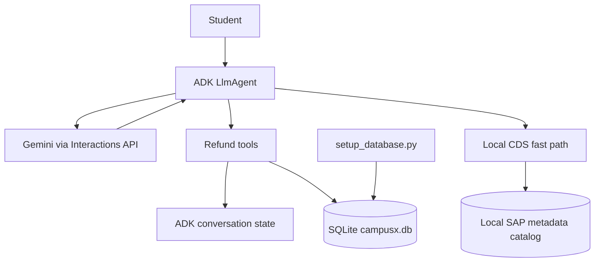

# Refund Bot

A Gemini assistant built with the Google Agent Development Kit (ADK). It
generates classic ABAP CDS projection views from verified local metadata, and
supports a demo course-refund workflow backed by SQLite. Refund requests are
simulated and do not transfer money.

## Requirements

- Python 3.12
- A Google AI Studio API key with access to the configured Gemini model
- Dependencies from `requirements.txt`

## Setup

Run these commands from the project root in PowerShell:

```powershell
.\myenv\Scripts\Activate.ps1
pip install -r requirements.txt
```

Create or update `refund_bot\.env` with your API key:

```dotenv
GOOGLE_API_KEY=your_google_ai_studio_api_key
```

Keep API keys private and do not commit `.env`. Rotate a key if it has been
exposed.

The sample database, `refund_bot\campusx.db`, is included with this workspace.
For a fresh copy without that database, initialize it once:

```powershell
python .\refund_bot\setup_database.py
```

The initializer refuses to overwrite an existing database.

## Run

Start an interactive session from the project root:

```powershell
adk run refund_bot
```

Or start the ADK web interface:

```powershell
adk web refund_bot
```

## Local MCP filesystem agent

The `mcp_server` agent uses Ollama's `llama3.2` model first and Gemini as a
fallback for retryable server errors. Install Ollama and Node.js, then pull the
local model:

```powershell
ollama pull llama3.2
```

Keep the Ollama service running. After installing project dependencies, start
the MCP agent from the project root:

```powershell
adk run mcp_server
```

Ollama must be running and the model must be present locally. If Ollama cannot
connect or the model is missing, ADK may not classify that as a retryable
server error and may not continue to Gemini.

## Demo behavior

- The assistant asks for the email associated with a sample student before
  reading enrollments or refund status.
- It checks the selected enrollment against the policy in the tools:
  purchase within 7 days and course completion at or below 20%.
- Eligible refunds are for the full amount paid in INR. A nonblank reason is
  required, but the reason does not affect eligibility.
- Submitting a request requires explicit ADK confirmation. A successful
  submission changes the enrollment status to `refund_requested`; it does not
  issue a real refund.
- The database also includes `refunded` records to demonstrate status queries.

Sample emails are `rahul@example.com`, `priya@example.com`,
`aman@example.com`, `neha@example.com`, and `vikram@example.com`.

## CDS view generation

Ask for a classic ABAP CDS projection view by SAP table name, for example:

```text
Generate a CDS view for MARA
```

The agent first checks
`refund_bot\cds_knowledge\metadata_catalog.json`. For covered tables it
renders a classic `define view` projection locally from the catalog. For an
uncovered table, it falls back to Gemini with Google Search, preferring
official SAP sources and citing available sources. The web fallback may be
slower; if it cannot verify the table's fields and keys, it should explain the
gap instead of guessing.

The catalog includes a small EKPO projection so EKPO requests can use the
local fast path without web search. It contains selected fields, not every
field in the table; verify its fields and keys against the target SAP system
and release. Add other verified entries in this format:

```json
{
  "tables": {
    "MARA": {
      "label": "Material projection",
      "source": "Reference document name, version, and section",
      "view_name": "ZI_MATERIAL",
      "sql_view_name": "ZIMATERIAL",
      "fields": [
        {"name": "MATNR", "alias": "Material", "key": true},
        {"name": "MTART", "alias": "MaterialType", "key": false}
      ]
    }
  }
}
```

The example shows the catalog format only; populate it with fields and keys
verified against your SAP release. `view_name` must be a valid uppercase ABAP
identifier no longer than 30 characters; `sql_view_name` must be a valid
uppercase identifier no longer than 16 characters. Each field needs a unique
valid name and alias and an explicit boolean `key`; mark at least one key. The
catalog's `source` is returned with the generated view. The generated source
is not activated in SAP and must be checked in the target ABAP system.

CDS requests covered by the catalog are handled by an ADK before-model
callback and returned without a Gemini call. Uncovered-table CDS requests fall
through to Gemini and the Google Search sub-agent for web-grounded results;
this fallback requires additional model/search work and may be slower. Other
questions use Gemini normally. End-to-end response time depends on Gemini,
Google Search, network conditions, and the hosting environment, so an
under-15-second response cannot be guaranteed.

## Architecture



The agent is defined in `refund_bot/agent.py`. It selects the
`gemini-3.8-flash` model and enables ADK's Interactions API support. It uses
the model's default thinking configuration. The tools in `refund_bot/tools.py`
validate the selected student, read and update enrollments, and enforce the
refund policy. The selected student ID and email are stored in ADK conversation
state; enrollment and refund data are stored in SQLite.
`refund_bot/setup_database.py` creates the demo schema and sample records. CDS
metadata is retrieved from the local JSON catalog in
`refund_bot/cds_knowledge/metadata_catalog.json`; covered CDS requests return
directly from an ADK callback, while uncovered CDS requests use Google Search
through ADK.

## Project files

```text
requirements.txt
refund_bot/
  agent.py
  tools.py
  setup_database.py
  cds_knowledge/
    metadata_catalog.json
  campusx.db
  .env                 # Local API key; do not commit
```
