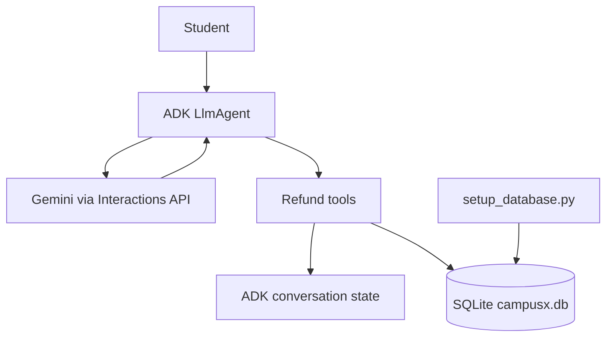

# Refund Bot

A demo course-refund assistant built with the Google Agent Development Kit
(ADK), Gemini, and SQLite. It looks up sample student enrollments, evaluates
refund eligibility, and records a simulated refund request after confirmation.
It does not transfer money.

## Requirements

- Python 3.12
- A Google AI Studio API key with access to the configured Gemini model
- Dependencies from `requirements.txt`

## Setup

Run these commands from the project root in PowerShell:

```powershell
.\myenv\Scripts\Activate.ps1
pip install -r requirements.txt
```

Create or update `refund_bot\.env` with your API key:

```dotenv
GOOGLE_API_KEY=your_google_ai_studio_api_key
```

Keep API keys private and do not commit `.env`. Rotate a key if it has been
exposed.

The sample database, `refund_bot\campusx.db`, is included with this workspace.
For a fresh copy without that database, initialize it once:

```powershell
python .\refund_bot\setup_database.py
```

The initializer refuses to overwrite an existing database.

## Run

Start an interactive session from the project root:

```powershell
adk run refund_bot
```

Or start the ADK web interface:

```powershell
adk web refund_bot
```

## Demo behavior

- The assistant asks for the email associated with a sample student before
  reading enrollments or refund status.
- It checks the selected enrollment against the policy in the tools:
  purchase within 7 days and course completion at or below 20%.
- Eligible refunds are for the full amount paid in INR. A nonblank reason is
  required, but the reason does not affect eligibility.
- Submitting a request requires explicit ADK confirmation. A successful
  submission changes the enrollment status to `refund_requested`; it does not
  issue a real refund.
- The database also includes `refunded` records to demonstrate status queries.

Sample emails are `rahul@example.com`, `priya@example.com`,
`aman@example.com`, `neha@example.com`, and `vikram@example.com`.

## Architecture



The agent is defined in `refund_bot/agent.py`. It selects the
`gemini-3.8-flash` model and enables ADK's Interactions API support. The tools
in `refund_bot/tools.py` validate the selected student, read and update
enrollments, and enforce the refund policy. The selected student ID and email
are stored in ADK conversation state; enrollment and refund data are stored in
SQLite. `refund_bot/setup_database.py` creates the demo schema and sample
records.

## Project files

```text
requirements.txt
refund_bot/
  agent.py
  tools.py
  setup_database.py
  campusx.db
  .env                 # Local API key; do not commit
```
